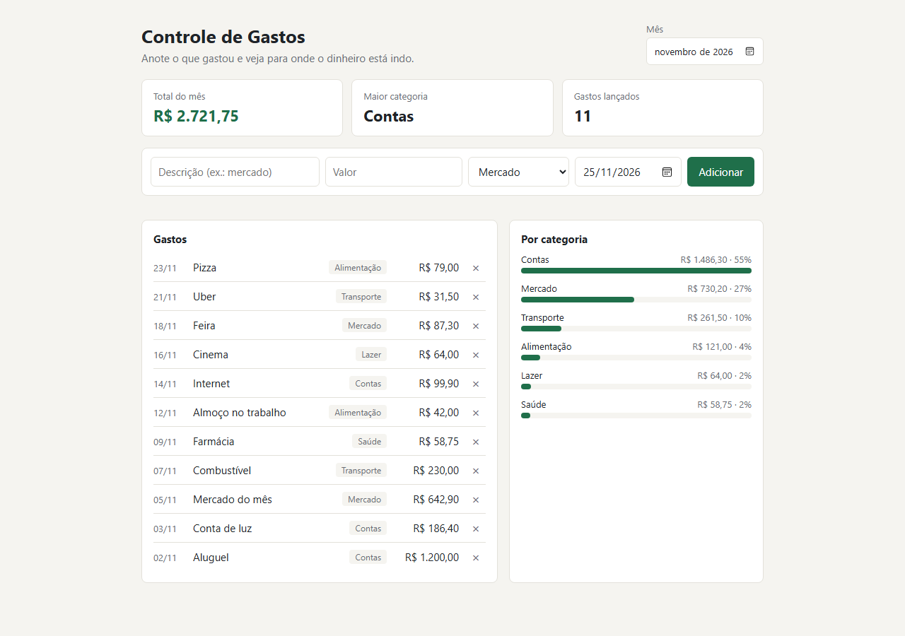

# Controle de Gastos

Aplicação web para anotar os gastos do dia a dia e ver, mês a mês, para onde o dinheiro está indo.

**[Ver online](https://felippegasques-bot.github.io/controle-gastos/)** · para abrir já com dados de exemplo: [?exemplo](https://felippegasques-bot.github.io/controle-gastos/?exemplo)

## O que faz

- Lança gastos com descrição, valor, categoria e data
- Filtra por mês e mostra o total, a categoria que mais pesou e quantos gastos foram lançados
- Mostra um gráfico de barras por categoria, feito só com HTML e CSS
- Guarda tudo no próprio navegador (localStorage), sem servidor
- Funciona no celular

## Como rodar

Não precisa instalar nada: baixe o repositório e abra o `index.html` no navegador.

## Tecnologias

JavaScript puro (sem bibliotecas), HTML e CSS.

## O que pratiquei

- Criar a lista com `createElement` e `textContent`, e não com `innerHTML`, para o texto digitado nunca virar código na página
- Filtrar, ordenar e agrupar dados por mês e por categoria
- Layout com CSS Grid que se adapta ao celular
- Manter os gastos salvos na primeira versão funcionando depois da mudança no formato dos dados

## Versões

- **v2:** categorias, datas, filtro por mês, resumo e gráfico por categoria
- **v1 (mar/2026):** lista simples com o total

Existe também uma versão com back-end em Python: [smart-budget](https://github.com/felippegasques-bot/smart-budget).
